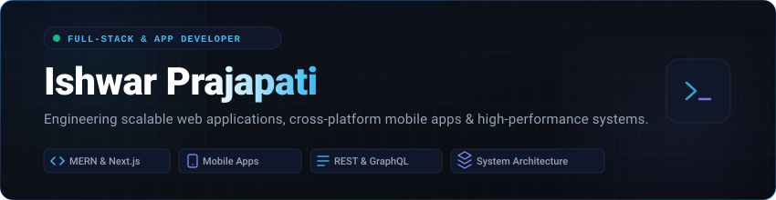

 

 

  
  
  

 

 

##  About Me

> **Full-Stack &amp; Mobile App Engineer** specializing in engineering scalable digital solutions, responsive frontend architectures, and high-throughput backend services. With over **70+ repositories** on GitHub, I build production-grade web and mobile applications with clean architecture and performance-first execution.

- **System Architecture:** Component-driven frontend execution, modular API design, and distributed full-stack workflows.
- **Core Ecosystem:** JavaScript / TypeScript, React, Next.js, Node.js, Express, MongoDB, and Tailwind CSS.
- **Engineering Standards:** Clean code practices, optimized runtime performance, and intuitive UX design.
- **Availability:** Open for software engineering roles, technical consultations, and high-impact contract projects.

 

 

##  Technical Capabilities

  <b>Frontend &amp; UI Architecture</b>  
  

 

  <b>Backend, APIs &amp; Databases</b>  
  

 

  <b>Mobile &amp; Core Languages</b>  
  

 

  <b>DevOps, Cloud &amp; Developer Tools</b>  
  

 

 

##  Developer Analytics &amp; Velocity

  

    

  

 

 

##  Contribution Activity

  <picture>
    <source media="(prefers-color-scheme: dark)" srcset="./assets/snake-dark.svg">
    <source media="(prefers-color-scheme: light)" srcset="./assets/snake-light.svg">
    
  </picture>

 

  
    
  <b>Engineering Scalable Software &amp; Digital Solutions</b>

